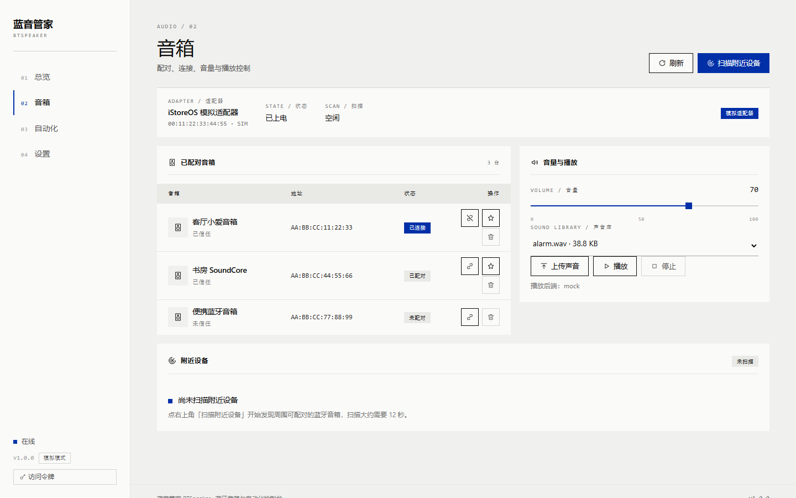
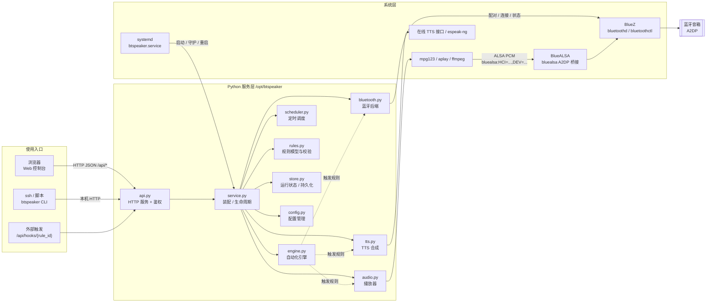

# 蓝音管家 BTSpeaker

**在 Linux 主机上，用浏览器连接、播放和控制蓝牙音箱，并把「什么时候放什么声音」变成自动化规则。**

蓝音管家是一个**独立 Web 服务应用**：纯 Python 标准库实现，不依赖任何第三方 Python 包，不占用 Docker、不引入 Node.js 构建链。一条命令装好后打开 `http://<主机IP>:8722` 即可使用；服务由 systemd 守护、开机自启，配置与数据都在 `/etc/btspeaker`。

支持 Debian / Ubuntu、Fedora、Arch Linux、openSUSE 等使用 systemd 的发行版（x86_64 / ARM 均可，纯 Python 无架构限制）。

---

## 功能一览

| 模块 | 能力 |
| --- | --- |
| 蓝牙管理 | 扫描附近设备、配对、连接/断开、信任、设为默认音箱、删除配对；后台轮询连接状态 |
| 声音库 | 内置提示音（`chime.wav` / `welcome.wav` / `alarm.wav`）+ 用户声音目录；支持在 Web 界面直接上传音频 |
| 播放控制 | 播放本地文件 / 声音库文件名 / HTTP(S) URL；音量调节、停止、循环播放 |
| TTS 播报 | 在线 TTS 接口（推荐，中文音质好）、`espeak-ng` 离线兜底、模拟模式；支持文本模板变量 |
| 定时任务 | 每天/指定星期几点几分、每 N 分钟执行；调度器每秒检查、不重复误触发 |
| 事件触发 | 蓝牙连接/断开/配对、开机后延迟、手动（网页按钮 / HTTP hook / 命令行） |
| 规则引擎 | 多动作顺序执行（播放、TTS、音量、连接、断开、命令、HTTP、等待、日志），条件判断、冷却时间 |
| **保存** | **声音库上传**（Web 上传音频即时入库）+ **配置备份导出**（一键下载 config + 全部规则 JSON，便于迁移/恢复） |
| Web 控制台 | 总览 / 音箱 / 自动化 / 设置 四个页面，归藏瑞士风（Swiss）视觉，全中文、纯离线（无 CDN） |
| HTTP API | JSON REST 接口，统一信封；可选 `api_token` 鉴权；可被 Home Assistant、脚本、crontab 调用 |
| 命令行 | `btspeaker status / devices / play / say / rules / logs / diag` 等，ssh 下脚本化 |
| 诊断 | Web `/api/diag`、`bt-diag.sh` 中文链路诊断、`journalctl -u btspeaker` 日志 |

## 界面预览

| 总览 | 音箱 |
| --- | --- |
|  |  |

| 自动化 | 设置 |
| --- | --- |
|  |  |

> 截图来自开发机**模拟模式**（`BTSPEAKER_SIM=1`，不接真实蓝牙硬件）；真机上连接真实音箱后，状态区会显示实际适配器、设备与播放状态。

## 架构



播放链路：`音频文件 → mpg123/aplay/ffmpeg 解码 → ALSA PCM "bluealsa:HCI=hci0,DEV=<MAC>,PROFILE=a2dp" → 蓝牙音箱`。

## 安装

### 方式一：一键安装（推荐）

```bash
curl -fsSL https://raw.githubusercontent.com/wangmou1406/btspeaker/main/install.sh | sudo bash
```

脚本会自动完成：

1. 识别发行版与包管理器（apt / dnf / pacman / zypper），安装依赖：
   `python3`、`bluez`、`bluez-alsa`（自动尝试多个包名）、`alsa-utils`、`mpg123`；
2. 部署程序到 `/opt/btspeaker`，启动器 `/usr/local/bin/btspeaker`；
3. 初始化数据目录 `/etc/btspeaker`（`config.json` + 5 条默认停用的示例规则）；
4. 安装 systemd 单元 `/etc/systemd/system/btspeaker.service`，`daemon-reload` + `enable --now`；
5. 打印访问地址与后续 3 条命令。

可选参数（把参数传给远程脚本）：

```bash
# 离线/依赖已自备：跳过系统包安装
curl -fsSL .../install.sh | sudo bash -s -- --no-deps

# 额外安装 espeak-ng（离线 TTS）与 ffmpeg（多格式解码）
curl -fsSL .../install.sh | sudo bash -s -- --optional

# 只预览计划、不改动系统（无需 root）
curl -fsSL .../install.sh | bash -s -- --dry-run
```

### 方式二：克隆仓库手动安装

```bash
git clone https://github.com/wangmou1406/btspeaker.git
cd btspeaker
sudo bash install.sh              # 安装 / 重复执行即升级覆盖
sudo bash install.sh --dry-run    # 先预览
sudo bash install.sh --no-deps    # 依赖已自行安装
sudo bash install.sh --optional   # 额外安装 espeak-ng / ffmpeg
```

> 内网/离线环境也可直接下载源码包解压后执行 `install.sh`；
> 或设置 `BTSPEAKER_SRC_DIR=/path/to/btspeaker` 让脚本使用指定源码目录。

### 依赖速查（脚本会自动安装；手动安装时参考）

| 发行版 | 一键命令 |
| --- | --- |
| Debian / Ubuntu | `sudo apt install python3 bluez bluez-alsa-utils alsa-utils mpg123` |
| Fedora | `sudo dnf install python3 bluez bluez-alsa alsa-utils mpg123` |
| Arch Linux | `sudo pacman -S python bluez bluez-alsa alsa-utils mpg123` |
| openSUSE | `sudo zypper install python3 bluez bluez-alsa alsa-utils mpg123` |
| 可选（离线 TTS / 多格式） | Debian: `espeak-ng ffmpeg`；Fedora/Arch/openSUSE 同名包 |

> `bluez-alsa` 是**蓝牙 A2DP 放音的关键**：它把音箱的蓝牙音频桥接成 ALSA PCM 设备。
> 各发行版包名不同（`bluez-alsa-utils` / `bluez-alsa` / `bluealsa`），安装脚本会自动尝试。
> 装不上时服务仍可启动，但播放会提示「未检测到 BlueALSA PCM」。

### 手动分步安装（不想用脚本时）

```bash
# 1) 依赖（按上表选择）
sudo apt install python3 bluez bluez-alsa-utils alsa-utils mpg123

# 2) 程序文件
sudo mkdir -p /opt/btspeaker /usr/share/btspeaker/sounds /etc/btspeaker/{sounds,tmp}
sudo cp -R btspeaker /opt/btspeaker/
sudo cp -R scripts /opt/btspeaker/scripts
sudo cp packaging/bin/btspeaker /usr/local/bin/btspeaker && sudo chmod 0755 /usr/local/bin/btspeaker
sudo cp packaging/systemd/btspeaker.service /etc/systemd/system/btspeaker.service
sudo cp assets/sounds/*.wav /usr/share/btspeaker/sounds/

# 3) 初始化配置与示例规则（幂等）
sudo PYTHONPATH=/opt/btspeaker python3 -m btspeaker seed --data-dir /etc/btspeaker

# 4) 注册并启动 systemd 服务
sudo systemctl daemon-reload
sudo systemctl enable --now btspeaker
```

## systemd 服务管理

```bash
sudo systemctl daemon-reload            # 修改 unit 后重载
sudo systemctl enable --now btspeaker   # 开机自启 + 立即启动
sudo systemctl status btspeaker         # 查看状态
sudo systemctl restart btspeaker        # 重启（改配置后）
sudo systemctl stop btspeaker           # 停止
sudo systemctl disable btspeaker        # 取消开机自启
journalctl -u btspeaker -f              # 实时日志
journalctl -u btspeaker -n 100 --no-pager   # 最近 100 行日志
```

## 使用入门

1. **打开控制台**：浏览器访问 `http://<主机IP>:8722/`（安装脚本结束时也会打印地址）。
2. **配对音箱**：进入「音箱」页 → 点击「扫描」→ 在列表里点「配对」并「连接」；也可以点「设为默认」，之后自动化规则会优先使用它。
   ```bash
   btspeaker devices --scan
   btspeaker pair AA:BB:CC:DD:EE:FF
   btspeaker connect AA:BB:CC:DD:EE:FF
   btspeaker default AA:BB:CC:DD:EE:FF
   ```
3. **试一下声音**：总览页点「播放提示音」，或命令行：
   ```bash
   btspeaker play chime.wav
   btspeaker volume 60
   btspeaker say 你好，我是蓝音管家
   ```
4. **保存自己的声音**：在「音箱」页（声音库区域）点「上传声音」，选择 mp3/wav 文件即可写入 `/etc/btspeaker/sounds/` 并立即出现在声音库下拉框中；也可直接把音频文件放进该目录后刷新。
5. **配置 TTS**：进入「设置」页填写 TTS 服务地址（支持 `{text}` / `{lang}` 模板变量），或安装 `espeak-ng` 作为离线兜底。TTS 未配置时，只有 `tts` 动作会报错，播放/规则其它功能不受影响。
6. **备份/迁移**：「设置」页点「导出配置备份」，会下载一个包含 `config.json` 与全部规则的 JSON 文件（也可 `curl -s http://127.0.0.1:8722/api/backup`）；规则可在「自动化」页单独导出/导入。
7. **启用自动化**：5 条示例规则默认**全部停用**，确认音箱正常后到「自动化」页逐条启用，或直接新建规则。

### 内置示例规则（首次启动自动写入，默认停用）

| 规则 | 触发器 | 动作 |
| --- | --- | --- |
| 早安播报 | 每周一至周五 07:30（冷却 600 秒） | 音量 60 → TTS「早上好，今天是{date}，{weekday}…」 |
| 回家迎宾 | 蓝牙连接任意音箱（冷却 300 秒） | 播放 `welcome.wav` → TTS 欢迎语 |
| 整点报时 | 每 60 分钟（冷却 60 秒） | 播放 `chime.wav` → TTS「现在是{time}。」 |
| 深夜自动静音 | 每天 23:00 | 音量调到 15 → 记录日志 |
| 手动测试播报 | 手动触发（冷却 5 秒） | 播放 `chime.wav` → TTS 测试播报 |

> 示例规则来自随包文件 `btspeaker/seed_rules.json`，由 `btspeaker seed` 写入 `/etc/btspeaker/rules.json`；已有规则文件时不会覆盖。恢复默认：备份/删除 `rules.json` 后执行 `sudo PYTHONPATH=/opt/btspeaker python3 -m btspeaker seed --data-dir /etc/btspeaker`。

### 规则长什么样

```json
{
  "name": "上班日八点新闻",
  "enabled": true,
  "cooldown": 60,
  "trigger": {"type": "schedule", "at": "08:00", "days": [0, 1, 2, 3, 4]},
  "conditions": [{"type": "connected", "value": true}],
  "actions": [
    {"type": "volume", "level": 70},
    {"type": "play", "source": "chime.wav", "label": "提示音"},
    {"type": "tts", "text": "现在是{time}，本地天气请查看手机。"}
  ]
}
```

触发器类型：`schedule`（`at` + `days`，或 `every_minutes`）、`bluetooth`（`connected` / `disconnected` / `paired`）、`boot`（开机延迟）、`manual`；动作类型：`play` `tts` `volume` `connect` `disconnect` `command` `http` `wait` `log`；模板变量：`{time}` `{date}` `{datetime}` `{weekday}` `{hostname}` `{bt_name}` `{bt_addr}` `{volume}` `{rule_name}` `{event}`。完整语法见 [docs/RULES.md](docs/RULES.md)。

### 常用命令

```bash
btspeaker status            # 服务状态与统计
btspeaker diag              # 蓝牙 / 音频 / TTS 链路自检
btspeaker logs -n 50        # 最近日志
btspeaker rules list        # 规则列表
btspeaker rules run <id>    # 立即执行一条规则
btspeaker info              # 系统信息
sudo sh /opt/btspeaker/scripts/bt-diag.sh   # 蓝牙链路诊断（中文修复建议）
```

## HTTP API 摘要

所有接口统一信封：成功 `{"ok": true, "data": ...}`，失败返回对应 HTTP 状态码与 `{"ok": false, "error": {"code": "...", "message": "中文"}}`。默认无鉴权；配置 `security.api_token` 后，除 `/api/health` 与静态资源外的 `/api/*` 需要请求头 `X-Api-Token: <token>` 或 `?token=<token>`。

| 方法 | 路径 | 说明 |
| --- | --- | --- |
| GET | `/api/health` | 健康检查（无需鉴权） |
| GET | `/api/status` | 总览状态：蓝牙 / 播放器 / 规则 / 引擎 / TTS |
| GET | `/api/system/info` | 版本、Python、平台、数据目录、运行时长 |
| GET / PUT | `/api/settings` | 读取（脱敏）/ 修改配置 |
| GET | `/api/bluetooth/devices` | 设备列表、当前连接、适配器信息 |
| POST / GET | `/api/bluetooth/scan` | 启动扫描 / 查询扫描结果 |
| POST | `/api/bluetooth/connect` · `/disconnect` · `/pair` | 连接 / 断开 / 配对 |
| POST | `/api/bluetooth/default` | 设置默认音箱 |
| DELETE | `/api/bluetooth/devices/{address}` | 删除配对记录 |
| GET | `/api/player` | 播放状态、音量、播放器自检 |
| POST | `/api/player/play` · `/stop` · `/volume` | 播放 / 停止 / 设置音量 |
| POST | `/api/tts/speak` | TTS 语音播报 |
| GET / POST | `/api/rules` | 规则列表 / 新建规则 |
| GET / PUT / DELETE | `/api/rules/{id}` | 查询 / 修改 / 删除规则 |
| POST | `/api/rules/{id}/run` · `/toggle` | 立即执行 / 启用停用 |
| GET / POST | `/api/rules/export` · `/import` | 规则导出 / 导入 |
| GET | `/api/library` | 声音库文件列表 |
| POST | `/api/library/upload?name=<文件名>` | 上传声音到库（请求体为音频原始字节，≤20MB） |
| GET | `/api/backup` | 导出配置备份（config + 全部规则，JSON 下载） |
| GET / DELETE | `/api/logs` | 日志查询 / 清空 |
| GET | `/api/events` | 最近规则执行记录 |
| GET | `/api/diag` | 系统自检结果与修复建议 |
| POST / GET | `/api/hooks/{rule_id}` | 外部触发某条 manual 规则（query 作为上下文） |

接口细节见 [docs/API.md](docs/API.md)。

## 目录结构

仓库：

```
btspeaker/
├── btspeaker/                 # Python 服务（安装到 /opt/btspeaker/btspeaker）
│   ├── __init__.py            # 版本与产品常量
│   ├── __main__.py / cli.py   # 命令行入口（serve / seed / status / devices / play / say ...）
│   ├── api.py                 # HTTP 服务、路由、鉴权、静态资源托管
│   ├── service.py             # 组件装配与生命周期（App / run_service）
│   ├── bluetooth.py           # 蓝牙后端（BlueZ CLI + 模拟后端）与状态轮询
│   ├── audio.py               # 播放器（mpg123 / aplay / ffmpeg / mock）
│   ├── tts.py                 # TTS（HTTP / espeak / mock）
│   ├── rules.py               # 规则模型、校验、RuleStore
│   ├── scheduler.py           # 定时调度线程
│   ├── engine.py              # 自动化引擎（触发匹配、动作执行、冷却、持久化）
│   ├── config.py              # 配置默认值 / 加载 / 落盘
│   ├── bus.py                 # 事件总线
│   ├── store.py               # JSON 存储与运行状态
│   ├── util.py                # 日志、命令、模板、时间等公共工具
│   ├── seed_rules.json        # 5 条示例规则（默认停用）
│   └── web/                   # 纯静态 Web 控制台（无构建、无 CDN）
├── packaging/
│   ├── systemd/btspeaker.service   # systemd 单元（安装到 /etc/systemd/system/）
│   ├── bin/btspeaker               # 启动器（安装到 /usr/local/bin/）
│   └── openwrt/                    # 历史归档：OpenWrt/iStoreOS 路线（不推荐，见下文）
├── scripts/
│   ├── bt-diag.sh             # 蓝牙链路中文诊断（systemd 版）
│   └── install-deps.sh        # 依赖安装/补装（按发行版，幂等）
├── assets/sounds/             # 内置声音库（chime / welcome / alarm）
├── install.sh                 # 一键安装（支持 curl | sudo bash）
├── uninstall.sh               # 卸载（默认保留配置，--purge 彻底删除）
├── docs/                      # INSTALL / FAQ / API / RULES / 截图
├── tests/                     # 标准库 unittest 测试
└── VERSION
```

安装后（Linux）：

```
/opt/btspeaker/btspeaker/               Python 包（含 web/ 与 seed_rules.json）
/opt/btspeaker/scripts/                 bt-diag.sh、install-deps.sh
/usr/local/bin/btspeaker                启动器（PYTHONPATH=/opt/btspeaker）
/etc/systemd/system/btspeaker.service   systemd 单元（开机自启）
/usr/share/btspeaker/sounds/            内置声音库
/etc/btspeaker/                         数据目录：config.json、rules.json、state.json、
                                        btspeaker.log、sounds/（用户上传）、tmp/
```

## 排障

先跑一遍诊断，大部分问题能直接定位：

```bash
sudo sh /opt/btspeaker/scripts/bt-diag.sh     # 服务/端口/蓝牙/BlueALSA/播放器/日志逐项检查
btspeaker diag                                # 服务内置自检（蓝牙/播放器/TTS）
journalctl -u btspeaker -n 100 --no-pager     # systemd 日志
tail -n 100 /etc/btspeaker/btspeaker.log      # 服务日志
```

| 现象 | 先检查 |
| --- | --- |
| 打不开网页 | `systemctl status btspeaker`、`ss -lntp | grep 8722`、`journalctl -u btspeaker -n 50` |
| 没声音 | `bluetoothctl info <MAC>` 是否 Connected、`aplay -L` 是否有 bluealsa、bluealsa 进程是否在运行 |
| bluealsa 未安装/未启动 | 按发行版装 `bluez-alsa-utils` / `bluez-alsa`，然后 `systemctl enable --now bluealsa` |
| 配不上对 | 音箱是否处于配对模式、`bluetoothctl show` 是否 Powered: yes、`rfkill list bluetooth` 是否被禁用 |
| TTS 不响 | 设置页 TTS 地址/方法/模板是否正确，或安装 `espeak-ng` 并切换后端 |
| 规则不触发 | 规则是否启用（示例默认全部停用）、`rules.enabled`、冷却时间、`btspeaker logs` 是否有 error |
| 依赖装不上 | 运行 `sudo sh /opt/btspeaker/scripts/install-deps.sh` 重试，或按上表手动安装 |

更细的排查步骤见 [docs/FAQ.md](docs/FAQ.md)。开发机无蓝牙硬件时可用模拟模式：

```bash
BTSPEAKER_SIM=1 python -m btspeaker serve --data-dir .btsdata --port 8722
```

## 卸载

```bash
# 仓库目录内
sudo bash uninstall.sh            # 停止并删除程序，保留 /etc/btspeaker 配置与数据
sudo bash uninstall.sh --purge    # 同时删除 /etc/btspeaker（配置、规则、日志、用户声音）
sudo bash uninstall.sh --dry-run  # 先预览
```

卸载会停止并禁用 systemd 服务 `btspeaker`，删除 `/etc/systemd/system/btspeaker.service`、`/opt/btspeaker`、`/usr/local/bin/btspeaker`、`/usr/share/btspeaker`；默认保留 `/etc/btspeaker`，重新安装后配置依旧可用。

## 历史归档：OpenWrt / iStoreOS

项目早期面向 iStoreOS（OpenWrt 系）x86_64 软路由，使用 opkg / procd / ipk 打包。该路线**自 1.0.0 起不再维护**，相关代码归档在 [`packaging/openwrt/`](packaging/openwrt/)，仅供历史参考，**不推荐使用**。普通 Linux 用户请忽略该目录，使用根目录的 `install.sh` 与 systemd 单元。

## 安全说明

- **面向局域网设计**：默认监听 `0.0.0.0:8722`，HTTP 明文传输，**不要直接暴露到公网**。如需远程访问，请使用 VPN，或反向代理 + TLS，并设置强 `api_token`。
- **API Token**：在「设置 → 安全」或 `config.json` 的 `security.api_token` 中设置后，除健康检查外的 API 都需要 `X-Api-Token`。命令行用 `--token` 或环境变量 `BTSPEAKER_TOKEN`。
- **命令执行默认关闭**：规则里的 `command` 动作只有在 `security.allow_commands=true` 时才允许，且 `security.command_allowlist` 非空时只允许前缀匹配的命令。开启前请确认主机仅自己可管理。
- **服务以 root 运行**：蓝牙控制（`bluetoothctl`）与 ALSA 放音通常需要 root 权限；请为系统账号设置强密码、限制 ssh 来源，并用防火墙限制 8722 只对可信网段开放。
- **上传文件限制**：声音库上传有格式白名单与大小上限（默认 20MB，可配 `sounds.max_upload_mb`），文件写入 `/etc/btspeaker/sounds/`，不会被执行。
- 所有 API 返回配置时会对 `api_token` 脱敏（`******`）；日志与状态接口不返回密钥。

## 开发

```bash
python -m unittest discover -s tests -v    # 全部测试（无需硬件/外网）
BTSPEAKER_SIM=1 python -m btspeaker serve --data-dir .btsdata --port 8722
```

- 目标环境：Linux + Python 3.9+；代码保持 Python 3.9 语法兼容、只用标准库。
- 开发机：Windows / macOS / Linux + Python 3.9+，模拟模式可完整跑通 Web、规则、TTS（mock）。
- 模块契约与接口约定见 [docs/CONTRACTS.md](docs/CONTRACTS.md)；测试从仓库根目录运行。

## 许可证

MIT，见 [LICENSE](LICENSE)。
